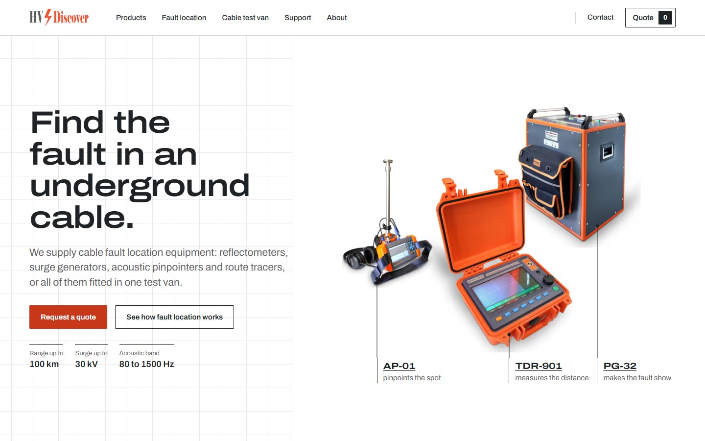
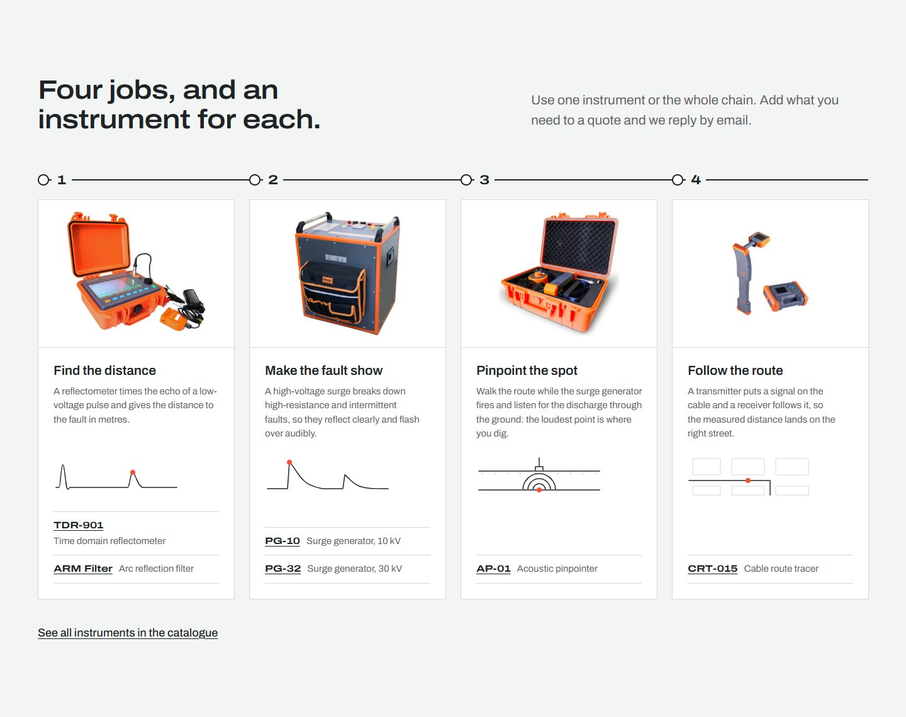
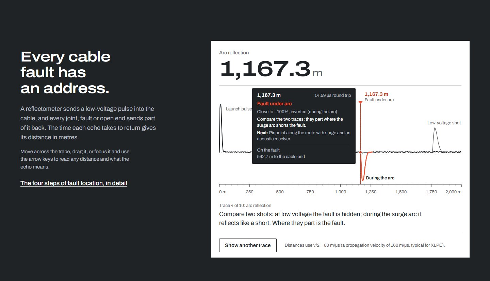
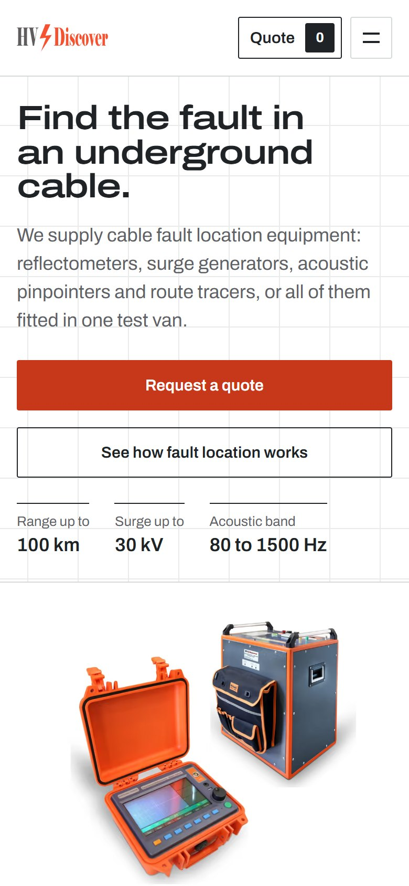
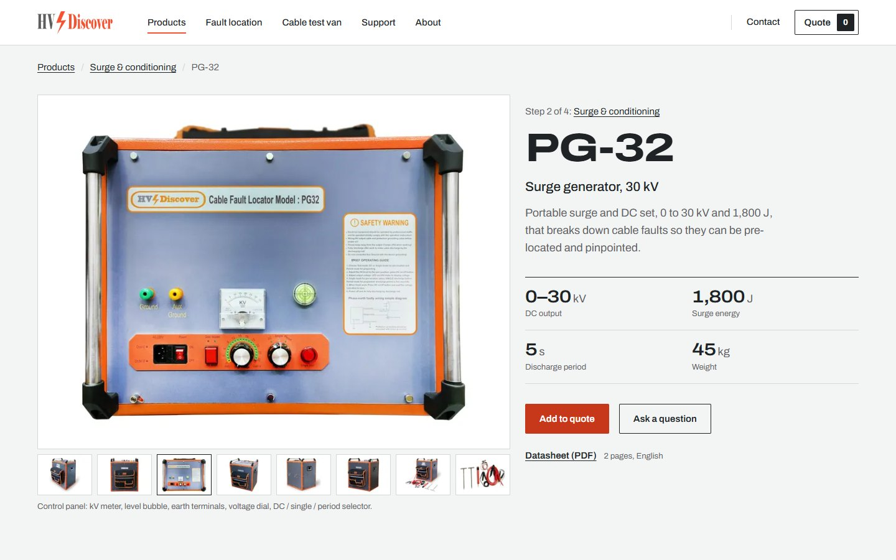
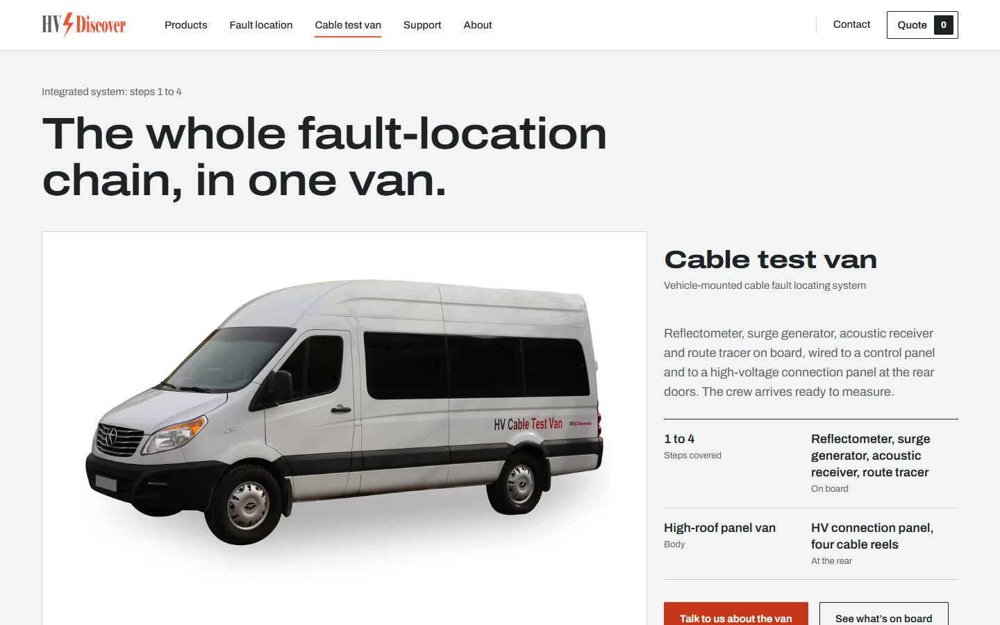

# HV Discover website

A product catalogue and request-a-quote website for HV Discover, a London supplier of underground
cable fault-location equipment: time domain reflectometers, surge generators, an arc reflection
filter, an acoustic pinpointer, a cable route tracer and a cable test van. The Home page opens on
what is supplied, shown with real equipment photography, then walks through the four jobs of fault
location and an instrument for each. It replaces a WordPress site built with Woodmart and Elementor
with a static site that is faster, accessible and easier to keep correct.

Live preview: https://soroush83faraz.github.io/hv-discover-website/



## Highlights

- **Design system.** Colour, type, spacing and layout come from one set of CSS tokens. The
  palette is taken from a medium-voltage cable cross-section, and the whole site uses one
  variable font (Archivo), with its width axis carrying the hierarchy instead of extra families.
- **A first screen that says what is supplied.** The Home page opens on the job ("Find the fault
  in an underground cable."), one sentence on what the company supplies, three real figures taken
  from the product files and a composition of three product photos (AP-01, TDR-901, PG-32) with
  leader-line captions that link to their pages.
- **Interactive TDR instrument.** A "how fault location works" band on the Home page holds a TDR
  instrument that synthesises ten different traces (open circuit, short circuit, high-resistance
  fault, arc reflection, wet section and more). Pointing at the trace, or tapping it on a phone,
  reads out the distance and opens a card that explains what the event on the trace means.
  `?trace=1` to `?trace=10` opens a scenario directly.
- **Request-a-quote list.** Any instrument can be added to a quote list from its tile or page;
  the list, with quantities, goes out with the quote form. The PHP form API behind it was
  security reviewed: signed single-use tokens, rate limits per client and overall, a honeypot,
  strict input validation and mail headers that cannot be injected.
- **Strict Content-Security-Policy.** No inline scripts or styles except one hashed line; the
  build computes the hashes and fails on anything the policy would block.
- **Every old URL redirected.** Each WordPress URL (pages, products, query-string IDs, the old
  `/index.php/` permalinks) reaches its new page in one 301, checked by more than 2,000 rule tests.
- **Datasheets from the product content.** The English datasheet PDFs are generated from the same
  Markdown files as the product pages, so a PDF never disagrees with its page.
- **Fast and accessible.** Lighthouse on mobile: performance 94–99, accessibility 100, best
  practices 100, SEO 100. Responsive AVIF/WebP images, one preloaded font file, no framework
  runtime.

| | |
|---|---|
|  |  |
| Four jobs, and an instrument for each | The TDR instrument band (`?trace=4`, arc reflection) |
|  |  |
| Home first screen at 390 px | Product page with gallery (PG-32) |



*Cable test van page.*

## Stack

- [Astro 5](https://astro.build/) with static output, TypeScript in strict mode
- Plain CSS on design tokens; no UI framework, no CSS framework
- Archivo variable font, self-hosted (width and weight axes)
- Product content as Markdown with a validated schema (Astro content collections)
- Images through `astro:assets` (AVIF and WebP at four widths)
- Form API in PHP 7.4+ with no dependencies; Apache `.htaccess` for the security headers,
  caching and redirects
- Build scripts in plain Node.js (built-in modules only)

## Project structure

```
site/                    the Astro project
  src/content/products/  one Markdown file per product: the single source of truth
  src/components/        one component per design-system part
  src/pages/             the routes (Home, catalogue, product pages, van, quote, support ...)
  src/scripts/           client TypeScript (TDR instrument, gallery, quote list, forms)
  src/styles/            tokens, base and component CSS
  public/                .htaccess template, robots.txt, datasheet PDFs
  scripts/               sync-api.mjs, csp-hashes.mjs, build-preview.mjs
  README.md              the full developer guide
api/                     the PHP form API (quote, contact, token endpoints)
  CLIENT.md              the contract between the site and the API
docs/screenshots/        the images in this README
.github/workflows/       builds and publishes the design preview
```

## Run it

Node 22 or newer is recommended.

```sh
cd site
npm ci
npm run dev            # http://localhost:4321
npm run build          # production build in site/dist/ (copies ../api into it first)
npm run build:preview  # the design preview for GitHub Pages in site/dist/
```

`npm run build:preview` takes the base path from `PREVIEW_BASE` (default `/hv-discover-website`).
The forms need PHP; `api/CLIENT.md` explains how to run the API locally.

## Notes

- **The live link is a design preview.** The forms are not connected there (a submit shows a
  message and sends nothing), every page is marked `noindex` and `robots.txt` disallows
  everything. The office address and opening hours shown on the site are placeholders.
- **Production** targets an Apache host with PHP: `npm run build` produces `site/dist/` with the
  `.htaccess` (CSP hashes filled in) and the form API in `dist/api/`; the API's configuration lives
  outside the web root. The deployment steps and checks are in `site/README.md`.
